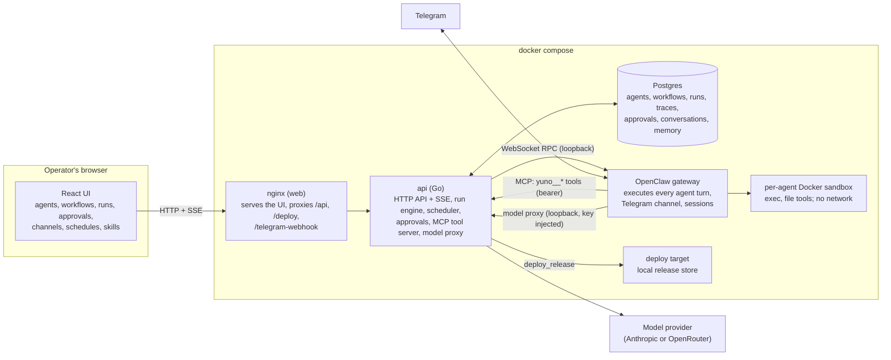

# Yuno Agent Orchestration Platform

A platform where operators configure AI agents (role, prompt, model, tool allowlist,
limits, schedules, memory, guardrails, interaction rules) without code changes, connect
them into multi-agent workflows with branching and feedback loops, and run them on a real
runtime against real tools, with a human approval gate in front of every side effect.
One agent is reachable over Telegram.

Agents execute on OpenClaw; this repository is the control plane around it (workflow
engine, approvals, limits, traces, evals, channel, UI). See `docs/adr/0001-runtime.md`.

Status: waves 1, 2 and 3 of 4 are done. Working end to end: agent configuration in the UI
and API, materialised into OpenClaw (config entry, exec policy, workspace files);
multi-agent workflows as graphs with conditions, feedback loops and typed state, built
in the visual builder or loaded from the two shipped templates; agent turns executed by
OpenClaw with `exec` in a Docker sandbox and the run directory handed forward from agent
to agent; the platform tools over MCP (`finish`, `deploy_release`, `http_fetch`,
`memory_save`, `memory_recall`, and `gitlab_create_mr` when configured) with
idempotency keys and a human approval gate in front of every side effect, answered from
the approvals inbox or the run page; approval nodes in workflows; exec approvals from
the gateway; retries; live traces over SSE with tokens, cost, agent messages and state;
step, time, cost, tool-call, loop and cancellation limits; one agent reachable over
Telegram through OpenClaw's native channel, with the conversation mirrored into the
platform and approvals from chat sessions in the inbox; cron and delay schedules;
per-agent guardrails (cost cap, runs per hour, blocked tools, input patterns); agent
memory with a retention policy, rendered into the agent's memory file; skills; and
`make eval` with seventeen public cases, seven evaluators and a rubric evaluator in
heuristic and model modes. Still to come: the recorded walkthrough video and the final evaluation report over
every split, both linked from this file when they exist. This file is kept truthful at
every commit.

## Where to look first

1. `docs/demo-script.md` and the walkthrough video linked in the Demo section: what the
   platform does, in the order a reviewer would ask.
2. `docs/adr/0001-runtime.md` and the Architecture section below: why OpenClaw executes
   the agents and Go orchestrates them, and what that costs.
3. `docs/DESIGN.md`: the rules the code was built from, numbered, with the tests they
   name; `docs/prd-compliance.md` maps both briefs onto them, with the disclosed
   deviations.
4. `internal/engine` (the run engine), `internal/httpapi/mcp.go` (the tool gate),
   `internal/openclaw` (the runtime contract) and `web/src` (the UI).
5. `docs/threat-model.md`, `docs/test-results.md`, `DECISIONS.md` and `AI_USAGE.md`.

Known limits, one line each: one shared API token, no users; the Docker socket is
mounted into the gateway container; exec guardrail patterns do not reach the sandbox;
approvals are decided in the web UI (the Telegram prompt's reply path is unverified);
schedules target workflows; the deterministic fallback covers the evaluation path.

## Run it

Requirements on the host: Docker (with compose v2) with a usable Docker socket, `make`
and `curl`. Nothing else is installed on the host; every toolchain runs in a container.
OpenClaw needs the socket to create agent sandboxes as sibling containers, and keeps its
state and agent workspaces under `./data/openclaw` (git-ignored).

```bash
cp .env.example .env     # fill in ANTHROPIC_API_KEY to use a real model; optional otherwise
make run                 # generates platform tokens, builds images stamped with the commit,
                         # starts postgres, openclaw, deploytarget, api, web, migrates, seeds
make smoke               # every service answers; gateway, socket and sandbox image checked
make probe-openclaw      # a real OpenClaw turn with a sandboxed exec, through the gateway
```

The api shares the gateway container's network namespace. A gateway that crashes or is
restarted in place comes back on its own (both containers carry a restart policy, the
api exits when its namespace dies and rejoins the restarted gateway, nginx re-resolves
the address; measured at about two minutes end to end). A gateway container that is
*recreated* gets a new identity the api cannot rejoin by itself: recreate `api` too
(`make run` does both).

Then open http://localhost:8080. Agents lists the seeded agents with their channel and
live state, Workflows has the two
templates ("From template" makes an editable copy; Run asks for the input), Approvals is
the inbox, Runs shows every run with its live trace, Channels binds one agent to Telegram
and shows the conversations, Schedules fires workflows on a cron or once (each firing is
recorded once per occurrence; a once-schedule that fired needs a new time to run again),
Skills holds the markdown skills agents can list, and Status shows the commit the stack was built
from, the gateway and the scheduler's next due time. Deleting an agent removes it from
the runtime too, and the api reconciles the runtime's agents with its own at start. `make help` lists every target. The
ones that matter:

| Target | What it does |
|---|---|
| `make run` | Build and start the stack, wait for readiness, seed the demo agents, print the URL |
| `make smoke` | Hit every service in the running stack and check the sandbox is isolated |
| `make test` | Go unit tests (against the `yuno_test` database) and frontend tests |
| `make test-integration` | Live tests against the running gateway, run serially |
| `make test-race` | The engine and event packages under the race detector (installs gcc in the throwaway tools container) |
| `make probe-openclaw` | A real OpenClaw turn with a sandboxed `exec`, the integration canary |
| `make probe-approval` | Verifies the gateway's plugin approval calls the side-effect gate relies on |
| `make seed` | Creates the six demo agents the workflow templates name (Coder, Reviewer, Deployer, Researcher, Critic, Writer); idempotent |
| `make eval` | Run the evaluation suite offline with the scripted provider against the running stack; `make eval-baseline` / `make eval-final` store the report |
| `make lint` | `go vet`, `staticcheck`, `eslint`, `tsc` |
| `scripts/mutation-check.sh` | Breaks a line of code, runs a test command, restores the file, and says whether the test caught it |
| `make logs` | Follow the api logs |
| `make tunnel` | Expose the web port via a cloudflared quick tunnel for Telegram webhooks |
| `make clean` | Stop everything and drop the database volume |

## Configuration

All settings are environment variables, listed with their defaults in `.env.example`.
The model upstream is `MODEL_UPSTREAM=anthropic` with `ANTHROPIC_API_KEY`, or
`MODEL_UPSTREAM=openrouter` with `OPENROUTER_API_KEY`: OpenRouter serves the same Claude
models through the Anthropic messages format, and the proxy rewrites model ids
(`claude-opus-5-5` becomes `anthropic/claude-opus-5.5`) and the auth header, so agents
are configured identically either way.
Telegram: `TELEGRAM_BOT_TOKEN` from BotFather and `TELEGRAM_ALLOWED_USER_IDS` (numeric
ids; only these users can talk to the bot or approve from chat). `TELEGRAM_MODE=webhook`
is the verified-inbound mode: `make tunnel` starts a cloudflared quick tunnel to a
listener that serves only `/telegram-webhook`, its `https://…trycloudflare.com` URL goes
in `PUBLIC_BASE_URL`, `TELEGRAM_WEBHOOK_SECRET` must be at least 32 characters (the
setup refuses webhook mode otherwise), the gateway registers the URL with Telegram and
answers a wrong secret with 401; `make smoke` checks both. `TELEGRAM_MODE=polling` works
without a public URL. The channel stays closed until an agent is bound on the Channels page
or with `PUT /api/channels/telegram/binding`; binding restarts the gateway in place
(about five seconds). Conversations are the agent's own sessions, not runs; they appear
under Channels with their transcript.

Tool settings: `DEPLOYTARGET_URL` (the local release store `deploy_release` publishes
to), `HTTP_FETCH_ALLOWLIST` (hosts `http_fetch` may reach; empty means none),
`GITLAB_BASE_URL`, `GITLAB_PROJECT_ID` and `GITLAB_TOKEN` (all three register
`gitlab_create_mr`), `MCP_TOOL_WAIT_SECONDS` (how long a gated tool call waits for the
human before the agent continues with `pending_approval`, default 540), `TOOL_OUTPUT_MAX_BYTES`. The memory
tools need the agent's `memory_policy.enabled`.
Secrets never go in the repository; the log handler redacts anything shaped like a
provider key (Anthropic or OpenRouter), a bot token, a run token or a bearer token, in
logs and in stored transcripts (see `internal/obs/redact.go`). Postgres is published on
loopback only.

Access: with `API_TOKEN` set, every `/api` request and stream needs `Authorization:
Bearer <token>`; the UI asks for the token once (stored in the browser) and offers Sign
out. The OpenAPI document declares the scheme. Without `API_TOKEN` the API is open,
which is only for a trusted machine.

## Tools

Platform tools are served to OpenClaw over MCP from the api (`/mcp`, bearer token) and
reach the model as `yuno__<name>`; every call carries the run token, is checked against
the agent's allowlist and interaction rules, and is recorded with its full input and
output. OpenClaw's built-ins run inside the agent's Docker sandbox.

| Tool | Risk | Talks to | Timeout | Input |
|---|---|---|---|---|
| `finish` | computational | postgres | 5 s | `{run_token, result}` validated against the node's output schema |
| `deploy_release` | side-effecting, approval by default | deploy target | 30 s + approval wait | `{run_token, version, notes, paths[]}` from `runs/<run id>/` |
| `gitlab_create_mr` | side-effecting, approval by default | GitLab (when configured) | 30 s + approval wait | `{run_token, title, description, paths[]}` |
| `http_fetch` | read-only | allowlisted https hosts | 15 s | `{run_token, url}`; output wrapped as untrusted content |
| `memory_save` | computational | postgres | 5 s | `{run_token, key, value, ttl_days?}` |
| `memory_recall` | read-only | postgres | 5 s | `{run_token, query}`; output wrapped as untrusted content |
| `read`, `write`, `edit`, `apply_patch`, `ls`, `exec`, `process` | OpenClaw built-ins | the sandbox | OpenClaw's | |

Side effects are idempotent: the key is a hash of run, node visit, tool and canonical
input; a repeat replays the stored result and says so (`replayed: true`), and the deploy
target enforces the same key on its side.

Guardrails per agent: a cost cap per run (the run's limit becomes the minimum across its
agents), runs per hour (429 at trigger, recorded on a schedule's last error), blocked
tools (removed from the agent's tool list and refused by the gate), and input patterns
(RE2 over the tool input; a match is refused with `input blocked by guardrail <name>`).
An agent with patterns on `exec` runs host commands only through an exec approval (the
platform denies the ones a pattern matches, the rest reach the inbox); the sandbox is the
one place OpenClaw does not gate, so a matching command inside it is not blocked (D-028).
Memory: with `memory_policy.enabled`, `memory_save` and `memory_recall` keep up to
`max_facts` facts (default 200, 30-day TTL, oldest evicted) and the 20 newest are written
into the agent's `MEMORY.md` before each turn.

## Workflows and approvals

A workflow is a graph of `start`, `agent`, `approval` and `end` nodes with edges that
carry optional conditions over the typed run state (`/reviewer/verdict eq approved`);
edges are tried in order and the first true one is taken, so a feedback loop is just an
edge back, bounded by `max_loop_visits`. Each agent node's task is a template over the
run input and the state so far; the agent's `finish` result is validated against the
node's output schema and becomes `state[<node>]`. The shipped templates live in
`templates/` (`dev_pipeline`: Coder → Reviewer ⇄ feedback → human approval → Deployer;
`research_pipeline`: Researcher → Critic ⇄ feedback → Writer). To add one, drop a JSON
file there with `key`, `name`, `description` and `definition`, naming agents by
`agent_name`; it loads at the next api start, and "From template" resolves the names to
your agents.

Approvals come in three kinds and share one inbox: a side-effecting tool call (the MCP
call blocks up to `MCP_TOOL_WAIT_SECONDS`; approved runs it in the same turn, rejected tells the
agent, and a late approval is executed by the platform with the same idempotency key), a
workflow `approval` node (the run pauses and releases its worker), and an OpenClaw exec
approval for a command outside the agent's policy. Every approval is also registered
with the gateway so OpenClaw's own surfaces can answer it.

Per-agent model settings: `thinking` is the reasoning control on OpenClaw (the agent's
`thinkingDefault`), and `max_tokens` reaches OpenClaw as the agent's `params.maxTokens`.
OpenClaw has no counterpart to `effort`; the API still accepts the field for
compatibility, but it changes nothing and the agent form no longer offers it.

## Layout

```
cmd/yuno/           one binary: api | migrate | seed | openclaw-init | deploytarget | eval
internal/httpapi/   HTTP routes, middleware, SSE, MCP and model-proxy endpoints
internal/engine/    run state machine, limits, approvals, resumption
internal/openclaw/  baseline gateway config (openclaw-init) and the gateway client
internal/workflow/  graph definition, validation, conditions, task templates
internal/tools/     platform tools served over MCP, idempotent executor, policy
internal/seed/      the six demo agents (`yuno seed`)
internal/channels/  Telegram binding and the keeper that re-asserts it on the gateway
internal/sched/     cron parsing and the scheduler tick
internal/guardrails/ cost cap, rate limit, blocked tools, input patterns
internal/memory/    facts, retention sweeper, MEMORY.md rendering
internal/model/     model proxy, scripted offline provider, price table
internal/store/     pgx repositories and embedded SQL migrations
internal/deploytarget/ local release store the deploy tool publishes to
internal/events/    in-process event hub behind SSE
internal/obs/       logging and redaction
internal/pathcheck/ relative-path validation shared by tools and the deploy target
api/openapi.yaml    the HTTP contract, served at /openapi.yaml and validated in tests
web/                React + Vite + TypeScript UI
docker/             Dockerfiles (api, web, the OpenClaw sandbox image) and nginx config
scripts/            smoke.sh, the three gateway probes (turn, approval, telegram), ensure-env.sh, mutation-check.sh
templates/          the two workflow templates, loaded at api start
evals/              versioned eval cases (twelve public, two private) and reports
docs/briefs/        the briefs the build agents worked from, per wave
docs/reviews/       independent review findings and dispositions, per wave
data/openclaw/      OpenClaw state and agent workspaces (created by make run, git-ignored)
docs/DESIGN.md      the design the code is built from, rule by rule
docs/adr/           architecture decision records
DECISIONS.md        assumptions and decisions log
AI_USAGE.md         how AI was used to build this
```

## Architecture



The control plane is the Go `api`: it owns the data model, the workflow engine (graph
walk, typed state, limits, approvals, retries), the scheduler, the platform tools served
over MCP, the model proxy that keeps the provider key out of the runtime, and the SSE
streams the UI follows. OpenClaw is the execution engine: every agent turn runs there,
with the agent's `SOUL.md`, `AGENTS.md`, `MEMORY.md` and skills materialised from the
platform's configuration, tools executed in a per-agent Docker sandbox, and the Telegram
channel handled natively. The api and the gateway share one network namespace so every
privileged channel between them (RPC, MCP, model proxy) is loopback only. Three layers,
three directories: `web/` (UI), `internal/httpapi` + `internal/engine` + `internal/tools`
(runtime integration and control), `internal/store` (persistence).

Interactive diagrams of the same system live under `.omm/` (eight perspectives: overall
architecture, request lifecycle, data flow, external integrations, state transitions,
routes and pages, command surface, storage, each node with a description and the files
it covers). `make omm-view` serves them at `http://<host>:3030` from a container
(`OMM_PORT` changes the port); `scripts/omm.sh validate` checks the diagrams. They are
regenerated with the project skill `/omm-scan`.

## Runtime choice

The platform embeds OpenClaw (`docs/adr/0001-runtime.md` has the full record). The short
version: the attached brief requires one of OpenClaw, OpenCode or Goose as the execution
engine; of the three, OpenClaw is the only always-on gateway with a stable WebSocket
protocol, per-agent sandboxing, a native Telegram channel with inbound verification, and
an agent model (markdown files, skills, memory) that maps onto the brief's configuration
dimensions. OpenCode is a stronger coding agent but has no channel or scheduler story;
Goose's extension model would have meant writing the channel and the sandbox ourselves.
The trade-off accepted: the platform's limits, approvals and idempotency are enforced
around OpenClaw's loop (by event, by tick and at the MCP gate) rather than inside a loop
we own, and several gateway behaviours had to be probed rather than read from docs; the
probes are committed (`make probe-openclaw`, `make probe-approval`, the Telegram probe).
Go for the control plane: one static binary behind every compose service, a standard
toolchain, and a type system that keeps a 30-table data model honest.

## Threat model and known limitations

`docs/threat-model.md` lists assets, trust boundaries, each threat with its mitigation
and the residual risk, and the known limitations. The headline items: model output and
every tool result are untrusted (schemas, allowlists, the approval gate and the
untrusted-content wrapper stand between them and a side effect); agent commands run in a
sandbox with no network; the provider key never reaches the runtime; secrets are redacted
from logs and traces; the Docker socket mounted into the gateway container is the one
root-equivalent surface, and exec guardrail patterns do not reach the sandbox.

## Evaluation

`make eval` runs the public split (17 cases) offline against the running stack with the
deterministic scripted model, seven evaluators (`termination`, `trace_integrity`,
`expectation`, `approval_gate`, `idempotency`, `schema`, `allowlist`) and the rubric in
heuristic mode, and writes `evals/reports/<timestamp>.md`. `make eval-baseline` stores
the report as `evals/reports/baseline.md`; `make eval-final` runs every split (24 cases;
the 7 private ones need the network, a configured GitLab or a human) and stores
`evals/reports/final.md`; `EVAL_PROVIDER=anthropic` grades the rubric with a real model
through the proxy. Cases live in `evals/cases/v1/` and are described in `evals/README.md`.
The baseline committed with wave 3 is 17 of 17 public cases, deterministic pass 1.000,
end-to-end success 1.000.

## Demo

The walkthrough video is `docs/demo/yuno-demo.mp4` (6 min 33 s, 1440x900, recorded from the
running build at commit `0c3afdd` on 2026-10-16, narrated; nothing simulated, the model
waits are cut and the cuts are listed in `scripts/demo/out/cuts.json` when regenerated).
`docs/demo-script.md` is the walkthrough the video follows: configuration (an agent's
dimensions, the dev pipeline template), a successful run with its live trace, a handled
failure (a loop limit), the approval gate in the inbox, the evaluation report, and a
live Telegram conversation with the bound agent.

## Adding a workflow template

Drop a JSON file in `templates/` with `key`, `name`, `description` and a `definition`
(see `templates/dev_pipeline.json`): nodes of kind `start`, `agent`, `approval`, `end`;
agent nodes name their agent with `agent_name` and carry a `task` template over
`{{.input.*}}` and `{{.state.<node>.*}}` plus an `output_schema`; edges in evaluation
order with optional `when` conditions over the state; `limits`. It loads at the next api
start as a read-only template; "From template" on the Workflows page resolves the agent
names to your agents (`make seed` creates the six the shipped templates use) and makes
an editable copy.

## Adding a messaging channel

Telegram is OpenClaw's native channel configured by the platform. Another OpenClaw
channel (Slack, WhatsApp, Discord) follows the same three steps: add its block to the
baseline config in `internal/openclaw/baseline.go` from the channel's environment
variables (`openclaw-init` writes it); extend `internal/channels` so the binding patch
writes a `bindings[]` entry whose `match.channel` names the new channel and the keeper
re-asserts it; and let the conversation mirror in `internal/engine/conversations.go`
recognise the channel's session keys (`agent:<id>:<channel>:…`). The Channels page reads
`GET /api/channels`, so a second card appears once the handler reports the channel. A
channel OpenClaw does not have would be an inbound adapter in the api instead: verify
the source (signature or secret), persist the update, and trigger a run on the bound
agent, with the reply sent through the channel's API.
