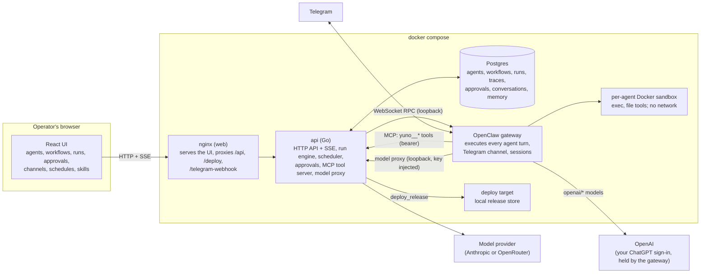

# Yuno Agent Orchestration Platform

A platform where operators configure AI agents (role, prompt, model, tool allowlist,
limits, schedules, memory, guardrails, interaction rules) without code changes, connect
them into multi-agent workflows with branching and feedback loops, and run them on a real
runtime against real tools, with a human approval gate in front of every side effect.
One agent is reachable over Telegram.

Agents execute on OpenClaw; this repository is the control plane around it (workflow
engine, approvals, limits, traces, evals, channel, UI). See `docs/adr/0001-runtime.md`.

Status: every planned wave (1 to 11) is built and live on the public instance. Working end to end: agent configuration in the UI
and API, materialised into OpenClaw (config entry, exec policy, workspace files);
multi-agent workflows as graphs with conditions, feedback loops and typed state, built
in the visual builder or loaded from the two shipped templates; agent turns executed by
OpenClaw with `exec` in a Docker sandbox and the run directory handed forward from agent
to agent; a project repository the platform clones for a run, with the sandbox image
chosen by the repository's toolchain and a merge request at the end (see Projects); the
platform tools over MCP (`finish`, `deploy_release`, `http_fetch`,
`memory_save`, `memory_recall`, `open_merge_request`, `gitlab_create_mr` when configured, and the Chief of Staff's chat tools) with
idempotency keys and a human approval gate in front of every side effect, answered from
the approvals inbox or the run page; approval nodes in workflows; exec approvals from
the gateway; retries; live traces over SSE with tokens, cost, agent messages and state;
step, time, cost, tool-call, loop and cancellation limits; one agent reachable over
Telegram through OpenClaw's native channel, with the conversation mirrored into the
platform and approvals from chat sessions in the inbox; cron and delay schedules;
per-agent guardrails (cost cap, runs per hour, blocked tools, input patterns); agent
memory with a retention policy, rendered into the agent's memory file; skills; and
`make eval` with twenty-one public cases, seven evaluators and a rubric evaluator in
heuristic and model modes; issue intake, iteration on an open merge request, questions to
the operator, run artifacts and parallel steps (fork and join). The walkthrough video and
the evaluation reports are described under Demo and Evaluation. This file is kept truthful
at every commit.

## Where to look first

1. `docs/demo-script.md` and the walkthrough video linked in the Demo section: what the
   platform does, in the order a reviewer would ask.
2. `docs/adr/0001-runtime.md` and the Architecture section below: why OpenClaw executes
   the agents and Go orchestrates them, and what that costs.
3. `docs/DESIGN.md`: the rules the code was built from, numbered, with the tests they
   name; `docs/prd-compliance.md` maps both briefs onto them, with the disclosed
   deviations.
4. `internal/engine` (the run engine), `internal/httpapi/mcp.go` (the tool gate),
   `internal/openclaw` (the runtime contract) and `web/src` (the UI).
5. `docs/threat-model.md`, `docs/test-results.md`, `DECISIONS.md` and `AI_USAGE.md`.

Known limits, one line each: one shared API token, no users, and without `API_TOKEN` the
API (approvals included) is open, which is why every non-local host sets it; a
side-effecting tool can be set to `auto` by the operator, which skips its approval; the
Docker socket is mounted into the gateway container; exec guardrail patterns do not reach
the sandbox; approvals are decided in the web UI (the Telegram prompt's reply path is
unverified); schedules start workflows, and a schedule for one agent targets a workflow
holding that agent; an operator retry or a resumed run starts a new node visit, so a
`deploy_release` can repeat (merge requests stay one per run); an expired conversation is
deleted from Postgres but the gateway keeps its own session; Telegram chats are not
counted against an agent's cost cap or runs-per-hour limit and their cost is not shown;
agent B reads agent A's output from the run's shared state in the same worker, and the
agent messages are the persisted trail of those hand-offs; the Chief of Staff looks a run
up by its id and cannot list recent runs; the deterministic fallback covers the
evaluation path.

## Run it

Requirements on the host: Docker (with compose v2) with a usable Docker socket, `make`
and `curl`. Nothing else is installed on the host; every toolchain runs in a container.
OpenClaw needs the socket to create agent sandboxes as sibling containers, and keeps its
state and agent workspaces under `./data/openclaw` (git-ignored).

```bash
cp .env.example .env     # fill in ANTHROPIC_API_KEY to use a real model; optional otherwise
make run                 # generates platform tokens, builds images stamped with the commit,
                         # starts postgres, openclaw, deploytarget, api, web, migrates, seeds
make smoke               # every service answers; gateway, socket and sandbox image checked
make probe-openclaw      # a real OpenClaw turn with a sandboxed exec, through the gateway
```

The api shares the gateway container's network namespace. A gateway that crashes or is
restarted in place comes back on its own (both containers carry a restart policy, the
api exits when its namespace dies and rejoins the restarted gateway, nginx re-resolves
the address; measured at about two minutes end to end). A gateway container that is
*recreated* gets a new identity the api cannot rejoin by itself: recreate `api` too
(`make run` does both).

Then open http://localhost:8080. Agents lists the seeded agents with their channel and
live state, Workflows has the three
templates ("From template" makes an editable copy; Run asks for the input), Approvals is
the inbox, Runs shows every run with its live trace, Channels binds one agent to Telegram
and shows the conversations, Schedules fires workflows on a cron or once (each firing is
recorded once per occurrence; a once-schedule that fired needs a new time to run again),
Skills holds the skills agents can be given (a library of seventeen ships with the
platform; more come from a zip or a Git repository), and Status shows the commit the stack was built
from, the gateway and the scheduler's next due time. Deleting an agent removes it from
the runtime too, and the api reconciles the runtime's agents with its own at start. `make help` lists every target. The
ones that matter:

| Target | What it does |
|---|---|
| `make run` | Build and start the stack, wait for readiness, seed the demo agents, print the URL |
| `make smoke` | Hit every service in the running stack and check the sandbox is isolated |
| `make test` | Go unit tests (against the `yuno_test` database) and frontend tests |
| `make test-integration` | Live tests against the running gateway, run serially |
| `make test-race` | The engine and event packages under the race detector (installs gcc in the throwaway tools container) |
| `make probe-openclaw` | A real OpenClaw turn with a sandboxed `exec`, the integration canary |
| `make probe-approval` | Verifies the gateway's plugin approval calls the side-effect gate relies on |
| `make probe-sandbox` | Verifies a per-agent sandbox image and network override on the running gateway, the mechanism project runs use |
| `make seed` | Creates the eight factory agents the shipped templates name (Analyst, Scout, Architect, Planner, Builder, Code Reviewer, Doc Auditor, Integrator) and the Chief of Staff, and deletes the nine retired demo agents (Coder, Reviewer, Deployer, Researcher, Critic, Writer and the three panel reviewers) unless a workflow of yours still uses one; idempotent |
| `make seed-reset` | `make seed`, then restores the shipped agents' prompts and allowlists (and the Claude model of any you moved to OpenAI) and the template workflows to the shipped versions, keeping everything else. `yuno seed --reset-shipped --keep-models --agent "Chief of Staff"` resets only the named agents and keeps their models, OpenAI included |
| `make eval` | Run the evaluation suite offline with the scripted provider against the running stack; `make eval-baseline` / `make eval-final` store the report |
| `make lint` | `go vet`, `staticcheck`, `eslint`, `tsc` |
| `scripts/mutation-check.sh` | Breaks a line of code, runs a test command, restores the file, and says whether the test caught it |
| `make logs` | Follow the api logs |
| `make tunnel` | Expose the web port via a cloudflared quick tunnel for Telegram webhooks |
| `make clean` | Stop everything and drop the database volume |

## The delivery process (Plan, Build, Ship)

Yuno runs a fixed delivery process against a project repository (DESIGN 5.28 and 5.29;
the plan and its mapping are in `docs/briefs/delivery-process/`). Eight agents do the
work: Analyst, Scout, Architect, Planner, Builder, Code Reviewer, Doc Auditor and
Integrator; the Chief of Staff stays the one agent on Telegram. Through it you can also ask
what is waiting for approval and approve or reject it, and add a repository as a project
(reusing the token of a project on the same host, or `PROJECT_GIT_TOKEN`; a token is never
typed in chat).

- **Plan** (`Plan pipeline`, once per feature, input `task` and a `feature` slug): the
  Analyst asks you about anything ambiguous and writes `PRD.md`; the Scout reviews it
  against the codebase and saves build and test facts as project notes; the Architect
  writes `ARCHITECTURE.md` and you approve it or send it back with a reason; the Planner
  writes `TASKS.md` (thin end-to-end slices) and `WAVES.md` (slices grouped so that no
  two in a wave touch the same file, and which holds at most 100 tickets in at most 30
  waves; the platform checks both when the Planner finishes and sends a plan that breaks
  them back before you are asked); you approve the plan;
  the Integrator commits the four documents under `docs/plans/<feature>/` in one merge
  request.
- **Publish**: after the plan's approval the Integrator opens the plan's merge request
  and publishes one tracker issue per ticket (`publish_tickets`, approval-gated, never
  duplicated on a retry), labelled `wave:<n>` and `feature:<feature>`; the plan appears in
  the project page's Plans section with its tickets, their issues, runs and merge
  requests, and every transition.
- **Build** (`Wave pipeline`, one run per ticket; intake starts it from the ticket's issue):
  the Builder writes the failing test first, then the code, and runs the whole suite; the
  Code Reviewer (a different model, which only reads) lists all its findings in its first
  review, numbered, and later rounds only check that each was fixed or declined for a
  good reason (at most three builds); the Integrator opens a
  draft merge request so the branch exists, and you pull it and test it (the manual-test
  approval; rejecting it sends your notes back to the Builder); the Doc Auditor writes
  the ticket's requirement trace, and notes on what the plan documents should say now, in
  the ticket's own file (`docs/plans/<feature>/tickets/<id>.md`); the Integrator marks the
  merge request ready with that file, under your manual-test approval. A ticket's merge
  request never changes `PRD.md`, `ARCHITECTURE.md`, `TASKS.md` or `WAVES.md`: Yuno leaves
  such edits out, since the wave's tickets build in parallel.
- **Escalation**: an agent that finds an unmet requirement or a design the build proved
  wrong calls `escalate`; that, or any ticket run that fails (the review loop's limit, a
  rejection), stops the ticket with its reason, pauses the project's waves and tells you
  on Telegram. Pause, resume and cancel a plan from its project page.
- **Waves**: when the plan's merge request merges, Yuno labels wave 1's issues for intake.
  Once every ticket of a wave is merged and the default branch's pipeline passed after the
  last merge, it starts the `Ship pipeline` for that wave (never while the project is
  paused or a revision of the plan runs). The project page shows each wave with its
  tickets, its ship run and main's status.
- **Ship** (`Ship pipeline`, one run per wave): you smoke test the deployed app (the
  smoke-test approval lists the wave's merge requests and main's pipeline); the
  Integrator saves the wave's lessons as project notes and calls `advance_wave`, which
  closes the wave's issues and releases the next wave. After the last wave you check the
  live app against `PRD.md` and accept the feature, which finishes the plan. Rejecting
  either approval pauses the waves with your reason. The Integrator also proposes one
  small merge request that applies the notes the wave's tickets left to the plan documents
  and appends the wave's lessons to the repository's `CLAUDE.md`, which you approve like
  any other.
- **Changes requested**: a ticket with a merge request has a Request changes action on
  the project page; your notes start another Wave pipeline run on the same merge request.
- **Revising a plan**: run `Plan pipeline` with `revise_plan` (the plan's id) and the
  change as the task. The agents amend the documents; the Integrator updates the changed
  tickets' issues, opens issues for new ones and closes dropped ones (finished waves are
  left alone), resets the current wave's failed tickets and resumes the waves. While the
  revision runs, no new wave is released and no ship run starts for the plan; tickets
  already building carry on. This is also how a ticket that escalated gets going again.

The earlier templates (`dev_pipeline`, `research_pipeline`, `review_panel`) and their
agents were retired with this change; their definitions are kept in `templates/legacy/`
and are not loaded. The state submitted to the Yuno partner project is the tag
`submitted-2026-10-19`.

## Agent files and skills

Every file OpenClaw reads from an agent's workspace is on the agent's page under
Workspace files (`GET /api/agents/{id}/files`). `SOUL.md`, `AGENTS.md` and `MEMORY.md`
are generated by the platform from the agent's configuration and saved facts; you add to
them in "Your additions", which is kept below the generated part, so the platform's own
rules stay in place. `IDENTITY.md`, `USER.md`, `BOOTSTRAP.md`, `HEARTBEAT.md`, `TOOLS.md`
and `DREAMS.md` are OpenClaw's; editing one makes your text the file's content until you
stop overriding it. Edits are stored in Postgres and written on every sync, so they
survive a gateway reset. A file that shows secrets masked cannot be edited from the page.

A skill is a `SKILL.md` with any scripts, references and assets beside it (at most 200
files, 2 MiB each, 20 MiB per skill). Upload one as a zip (`POST /api/skills/import`), or
import it from a public Git repository on an allowed host (`POST /api/skills/import-git`,
hosts in `SKILL_IMPORT_HOSTS`, default `github.com,gitlab.com`); the Skills page shows
each skill's files, edits its text files and exports it as a zip. An agent that holds a
skill gets the whole folder under `skills/<name>/` in its workspace, executable bits
included; its scripts run only through `exec` in the agent's sandbox. The library under
`skills-library/` (Anthropic's Apache-2.0 skills, four of OpenClaw's MIT skills and two
MIT-0 ClawHub skills; sources, commits, licences and review notes in
`skills-library/SOURCES.md`) is imported at start and assigned to no agent; a skill you
already have with the same name is never overwritten.

## Configuration

All settings are environment variables, listed with their defaults in `.env.example`.
The model upstream is `MODEL_UPSTREAM=anthropic` with `ANTHROPIC_API_KEY`, or
`MODEL_UPSTREAM=openrouter` with `OPENROUTER_API_KEY`: OpenRouter serves the same Claude
models through the Anthropic messages format, and the proxy rewrites model ids
(`claude-opus-5-5` becomes `anthropic/claude-opus-5.5`) and the auth header, so agents
are configured identically either way.

OpenAI models (D-091): an agent can run on `openai/gpt-6-astra`, `openai/gpt-5.6-terra`
or `openai/gpt-5.6-luna` with your own ChatGPT/Codex subscription instead of the
Anthropic key. Sign the gateway in once, on the host (on the public host too):

    docker exec -it yuno-openclaw openclaw models auth login --provider openai --device-code --agent main

It prints a code to enter at the ChatGPT address it shows. The sign-in is kept in the
gateway's state directory (`data/openclaw`) under the default agent, which every agent
shares, so any agent set to an OpenAI model uses it; the api never sees it. Then choose the
model in the agent's form, under "OpenAI (your ChatGPT subscription)". The shipped agents
stay on Claude, a seed keeps the model you chose, and `make seed-reset` moves an agent you
switched back to its shipped Claude model. A subscription is paid in quota, so the cost the
run pages show for these calls is the gateway's estimate at OpenAI's API prices; budgets
and cost limits count it. In the same container, `openclaw models auth list --provider
openai --agent main` shows the sign-in and `openclaw models auth logout <profile id> --yes`
removes it. Max tokens has no effect on the subscription route, and a thinking level the
model lacks is mapped to the nearest one it has.

Telegram: `TELEGRAM_BOT_TOKEN` from BotFather and `TELEGRAM_ALLOWED_USER_IDS` (numeric
ids; only these users can talk to the bot or approve from chat). `TELEGRAM_MODE=webhook`
is the verified-inbound mode: `make tunnel` starts a cloudflared quick tunnel to a
listener that serves only `/telegram-webhook`, its `https://…trycloudflare.com` URL goes
in `PUBLIC_BASE_URL`, `TELEGRAM_WEBHOOK_SECRET` must be at least 32 characters (the
setup refuses webhook mode otherwise), the gateway registers the URL with Telegram and
answers a wrong secret with 401; `make smoke` checks both. `TELEGRAM_MODE=polling` works
without a public URL. The channel stays closed until an agent is bound on the Channels page
or with `PUT /api/channels/telegram/binding`; binding restarts the gateway in place
(about five seconds). Conversations are the agent's own sessions, not runs; they appear
under Channels with their transcript.

Tool settings: `DEPLOYTARGET_URL` (the local release store `deploy_release` publishes
to), `HTTP_FETCH_ALLOWLIST` (comma-separated hosts `http_fetch` may reach; unset or empty uses the default `docs.python.org,pypi.org,raw.githubusercontent.com`),
`GITLAB_BASE_URL`, `GITLAB_PROJECT_ID` and `GITLAB_TOKEN` (all three register
`gitlab_create_mr`), `PROJECT_TOKEN_KEY` (encrypts the git tokens of the projects
created in the UI; generated by `make run`) and the `PROJECT_*` bootstrap of the
Projects section, `MCP_TOOL_WAIT_SECONDS` (how long a gated tool call waits for the
human before the agent continues with `pending_approval`, default 540), `TOOL_OUTPUT_MAX_BYTES`,
`BUDGET_TICK` (how often project spend is checked for budget alerts, default 60 s) and
`MERGE_REQUEST_SYNC_INTERVAL` (how often open merge requests are refreshed from their
provider, default 120 s) and `INTAKE_POLL_INTERVAL` (how often projects with issue intake
enabled are polled for labelled issues, default 120 s). `ARTIFACT_DIR` (where the api
keeps the files runs deliver, the `artifacts` volume) and `ARTIFACT_TTL_DAYS` (how long
after a run finished they are kept, default 30; 0 keeps them). `MODEL_STALL_AFTER` (how
long a step may wait on the model's reply with nothing arriving and no tool running before
its turn is stopped and continued, default 10m; 0 turns it off). The memory tools need the
agent's `memory_policy.enabled`.
Secrets never go in the repository; the log handler redacts anything shaped like a
provider key (Anthropic or OpenRouter), a bot token, a run token or a bearer token, in
logs and in stored transcripts (see `internal/obs/redact.go`). Postgres is published on
loopback only.

Access: with `API_TOKEN` set, every `/api` request and stream needs `Authorization:
Bearer <token>`; the UI asks for the token once (stored in the browser) and offers Sign
out. The OpenAPI document declares the scheme. Without `API_TOKEN` the API is open,
which is only for a trusted machine.

## Tools

Platform tools are served to OpenClaw over MCP from the api (`/mcp`, bearer token) and
reach the model as `yuno__<name>`; every call carries the run token, is checked against
the agent's allowlist and interaction rules, and is recorded with its full input and
output. OpenClaw's built-ins run inside the agent's Docker sandbox.

| Tool | Risk | Talks to | Timeout | Input |
|---|---|---|---|---|
| `finish` | computational | postgres | 5 s | `{run_token, result}` validated against the node's output schema |
| `deploy_release` | side-effecting, approval by default | deploy target | 30 s + approval wait | `{run_token, version, notes, paths[]}` from `runs/<run id>/` |
| `gitlab_create_mr` | side-effecting, approval by default | GitLab (when configured) | 30 s + approval wait | `{run_token, title, description, paths[]}` |
| `open_merge_request` | side-effecting, approval by default | the run's project on GitLab or GitHub | 120 s + approval wait | `{run_token, title, description, paths?, draft?}`; commits the run's checkout (or only the `paths`, files or directories relative to its root), pushes a branch and opens the request; `draft: true` opens it as a draft (GitLab `Draft: ` title prefix, GitHub draft pull request), and a later call of the run with `draft: false` marks it ready and replaces its title and description; a node's `auto_after: <approval node>` lets that ready update run without a second approval once the approval was granted |
| `http_fetch` | read-only | allowlisted https hosts | 15 s | `{run_token, url}`; output wrapped as untrusted content |
| `memory_save` | computational | postgres | 5 s | `{run_token, key, value, ttl_days?, scope?}`; `scope: "project"` saves a note shared by every agent of a run on the project |
| `memory_recall` | read-only | postgres | 5 s | `{run_token, query, scope?}`; output wrapped as untrusted content |
| `ask_operator` | computational | postgres | the approval wait + 30 s | `{run_token, question, options?}`; blocks for the operator's answer up to the wait, then the step parks until it arrives |
| `read`, `write`, `edit`, `apply_patch`, `ls`, `exec`, `process` | OpenClaw built-ins | the sandbox | OpenClaw's | |

Side effects are idempotent: the key is a hash of run, node visit, tool and canonical
input; a repeat replays the stored result and says so (`replayed: true`), and the deploy
target enforces the same key on its side.

Guardrails per agent: a cost cap per run (the run's limit becomes the minimum across its
agents), runs per hour (429 at trigger, recorded on a schedule's last error), blocked
tools (removed from the agent's tool list and refused by the gate), and input patterns
(RE2 over the tool input; a match is refused with `input blocked by guardrail <name>`).
An agent with patterns on `exec` runs host commands only through an exec approval (the
platform denies the ones a pattern matches, the rest reach the inbox); the sandbox is the
one place OpenClaw does not gate, so a matching command inside it is not blocked (D-028).
Memory: with `memory_policy.enabled`, `memory_save` and `memory_recall` keep up to
`max_facts` facts (default 200, 30-day TTL, oldest evicted) and the 20 newest are written
into the agent's `MEMORY.md` before each turn.

## Workflows and approvals

A workflow is a graph of `start`, `agent`, `approval`, `fork`, `join` and `end` nodes
with edges that carry optional conditions over the typed run state (`/reviewer/verdict eq
approved`); edges are tried in order and the first true one is taken, so a feedback loop
is just an edge back, bounded by `max_loop_visits`. Each agent node's task is a template over the
run input and the state so far; the agent's `finish` result is validated against the
node's output schema and becomes `state[<node>]`. The shipped templates live in
`templates/` (`plan_pipeline`, `wave_pipeline` and `ship_pipeline`, the delivery process; the former
`dev_pipeline`, `research_pipeline` and `review_panel` are kept as examples in
`templates/legacy/`, which is not loaded). To add one, drop a JSON
file there with `key`, `name`, `description` and `definition`, naming agents by
`agent_name`; it loads after the next build and start (`make run`), and "From template" resolves the names to
your agents.

Approvals come in four kinds and share one inbox: a side-effecting tool call (the MCP
call blocks up to `MCP_TOOL_WAIT_SECONDS`; approved runs it in the same turn, rejected tells the
agent, and a late approval is executed by the platform with the same idempotency key), a
workflow `approval` node (the run pauses and releases its worker), an OpenClaw exec
approval for a command outside the agent's policy, and a question from an agent (below).
Every approval but a question is also registered with the gateway so OpenClaw's own
surfaces can answer it.

An agent that is missing one fact can ask for it instead of guessing (DESIGN 5.24): the
`ask_operator` tool (the shipped Analyst, Architect and Builder hold it) puts a question, with up to
five suggested answers, into the inbox as an approval of kind Question and blocks the
call for the same wait as a gated tool; an answer within the wait reaches the agent in the
same turn. Past the wait the agent is told to save its progress and end its turn, the
step parks (the run waits with no worker, the time limit paused), and the answer
re-queues it: the step runs again as a continuation visit with every answer of the step
in its task, which does not count toward `max_loop_visits`. The question is announced
where the run reports (its conversation, or else the Telegram-bound agent's latest one),
and the Chief of Staff relays the person's reply with `answer_question`; the operator may
also decline, and the agent then proceeds and states what it assumed. A question nobody
answers within `approval_timeout_seconds` fails the run with `question unanswered`,
which Retry asks again. At most three questions per step and one pending at a time.

A run can deliver files (DESIGN 5.25): whatever an agent puts under `runs/<run id>/out/`
is collected when its step ends, one entry per path (a later step that changes a file
replaces it), kept under `ARTIFACT_DIR` for `ARTIFACT_TTL_DAYS`, and listed on the run
page's Artifacts section with Download and a preview for small text and images; a
project run also gets `diff.patch`, the checkout against the commit it cloned, produced
in a private clone on the api side (never with the checkout's own `.git`). Downloads
are attachments with `nosniff`, never rendered inline, and `run_status` names the files
with the run's link for the Chief.

Steps can run in parallel (DESIGN 5.26): a `fork` node starts one branch per outgoing
edge whose condition holds (two to five), every branch runs at once as its own agent
visits, and the fork's `join` continues when all of them are done, along its first true
edge. Only agent steps live inside a branch, no edge enters or leaves a branch except
through the fork and the join, forks do not nest, and two branches never share an agent
(each agent has one workspace). The first branch to fail stops its siblings and fails the
run; the run's step, tool-call and cost limits sum across branches and the time limit is
wall clock, so a gated call or a question inside a branch pauses only its own step while
the siblings keep working (the human gate goes after the join). A branch that asks the
operator and is left waiting parks; the run keeps going until every branch is done or
parked, then waits for the answer like any parked step. After the join every branch's
files flow on, but a project checkout flows only from the branch the join names as its
`checkout`, never as a mixture of two working trees. The run page shows a fork as one
card with its branches side by side; `run_status` names the branches while they run. The
`templates/legacy/review_panel.json` is the example: three reviewer agents (security,
performance, maintainability) read the Coder's change at the same time and the Reviewer
merges their verdicts.

Per-agent model settings: `thinking` is the reasoning control on OpenClaw (the agent's
`thinkingDefault`), and `max_tokens` reaches OpenClaw as the agent's `params.maxTokens`.
OpenClaw has no counterpart to `effort`; the API still accepts the field for
compatibility, but it changes nothing and the agent form no longer offers it.

## Projects: a repository, its toolchain, a merge request

A project is a git repository the platform works on, created on the Projects tab
(DESIGN 5.17, D-038): a name, the https clone URL (no credentials in it), the provider
(`gitlab` or `github`, detected from the host when left to the page), the default branch
(`main` by default), a description, a sandbox network opt-in, and a git token with write
access (on GitLab a project or personal access token with `api` and `write_repository`;
on GitHub a fine-grained token with contents and pull requests read and write). The
token is write-only: the API never returns it (`token_set` says one is stored), the page
shows "A token is set" and takes a new one to replace it, and the database holds it
AES-GCM encrypted under `PROJECT_TOKEN_KEY`, a platform secret `make run` generates into
`.env` like the gateway and MCP tokens. Keep that key with your `.env`: without it every
stored token is unreadable and has to be entered again. Check on a project's row lists
the repository through the provider's API with the stored token and says whether it was
accepted, whether the default branch exists and whether the token can push, without a
clone. Deleting a project removes it from the lists; its runs keep their history.

Every run on a project names it. A workflow opts in with `project: true` on its
definition (the builder's switch; the shipped plan and wave pipelines opt in), and the Run dialog
then asks for the project; a quick run from an agent offers an optional project. The run
keeps a snapshot of the project's settings, shown on the runs list and the run page with
a link to the project. The engine clones the default branch at depth 1 into
`runs/<run id>/repo/` of the first agent's workspace before its turn, reading the token
from the project at that moment (a replaced token applies to runs in flight, a deleted
project still finishes its runs); later agents receive the checkout with the rest of
the run directory. No agent clones, commits or pushes, and no model sees the token: the
api's own git runs with the token in its environment, the checkout holds the bare URL,
and the task protocol block tells each agent where the checkout is, which toolchain it
has and whether the sandbox has network.

The toolchain is read from the repository's manifest when it is cloned: `go.mod` is
`go`; `package.json` with `pnpm-lock.yaml`, `yarn.lock` or `package-lock.json` is
`node`; `uv.lock`, `requirements*.txt` or `pyproject.toml` is `python`; anything else is
`default`. It is recorded on the run (a badge on the run page, in the list and on the
project's row for its last run) and it selects the sandbox image for every visit of that
run: `yuno-sandbox-go`, `yuno-sandbox-node` and `yuno-sandbox-python`, built by `make
run` from `docker/sandbox-*.Dockerfile` with git and the toolchain's package manager and
test runner and nothing project-specific, or the default image for `default`. The
engine sets the image on the agent for the visit's duration (a per-session sandbox, so
each visit starts a fresh container) and restores the defaults afterwards; `make
probe-sandbox` verifies that mechanism on the running gateway.

Every tool the sandbox images install (`pytest`, `uv`, `pnpm`) is pinned to an exact
version, and each base image names its release line, so a new release of one never
reaches a run on its own. The images carry none of a project's own linters or test
runners: those come from the project's lockfile. When a project leaves them unpinned and
a new release breaks its checks (a linter adding a rule, say), the Scout and the Builder
report it and propose pinning the tool in the project instead of changing unrelated code.

Sandbox network is off by default: the run still clones, and agents work with what the
image provides. The project's network opt-in gives the sandboxes of its runs network
access, and the task tells the Builder to install dependencies from the lockfile first
(`npm ci`, `pnpm install --frozen-lockfile`, `go mod download`, `uv sync` or a `.venv`
with pip) and to run the project's tests. Network on means anything injected into the
repository can reach the internet from the sandbox and side effects inside the sandbox
are not gated, so it is for trusted repositories only (`docs/threat-model.md`).

At the end, the Integrator calls `open_merge_request` with a short title (a commit
subject, at most 72 characters) and a description. The Integrator runs no commands, so
the description ends with a "How it was checked" line that reports only what the run's
earlier steps verified (the Builder's tests, the Code Reviewer's verdict, your manual
test), or says "Not run in this task; the project's CI checks this merge request." when
the run verified nothing, as in a quick run. The tool is approval-gated like every
side effect and idempotent by the run's key: it clones the default branch again into a
private directory of the api (never running git inside the agent-writable checkout,
where a planted hook would run on the api side), copies the checkout's working tree over
it without `.git`, dependency and cache directories or links, commits as Yuno with the
title, pushes `yuno/<key>` from the api and opens the merge request (GitLab) or pull
request (GitHub) against the default branch. A run has one request (DESIGN 5.20): the
call records it, and a later call in the same run (a review loop, a retry) commits the
working tree on top of the request's branch and says `replayed` and `updated` rather
than opening a second one; a call on a request that was merged or closed is refused.
The platform then follows the request: every two minutes it reads its state, its
pipeline and its unresolved review threads from the provider, shows them on the run
page's Merge request card and on the project page, lets the operator Sync on demand and
Merge with a confirmation (refused while the pipeline is pending or failed, and by the
provider when it is not mergeable), and reports "merged" or "closed without being
merged" once into the conversation that asked for the work. A run delegated from
Telegram reports the link back into the chat when it ends, and if the request was
approved after the run had ended, a follow-up message carries it. `gitlab_create_mr`
stays for runs without a project.

A project also carries what a run on it should know (DESIGN 5.18): an Instructions text
the operator writes on the project form (conventions, how to build and test, what to
leave alone), rendered into every visit's task after the checkout lines, and project
notes, facts any agent of a run on the project saves with `memory_save` and `scope:
"project"` (the shipped Scout and Builder are told to save how the project is built
and tested), of which the ten newest are rendered into the task too and all are listed
and deletable on the project page. Notes expire after 90 days, a project keeps at most
100, and the two blocks together never exceed 12 KiB of the task.

A project can have a budget (DESIGN 5.19): a cap per UTC day and per UTC month in USD.
Spend is the cost of the project's runs created in the window, whatever their status;
the Projects list and the project page show spent over cap. At the cap, new work on
the project is refused where it is asked for (`429 project_budget_reached` on a run
request or a retry, a tool error the Chief relays on a delegation, `last_error` on a
schedule), running runs finish under their own limits, and the operator gets one alert
at 80 % and one at the cap per window, posted into the Chief of Staff's latest Telegram
conversation like a run report (a log line and the page when nothing is bound).

A run that ended `failed`, `timed_out` or `cancelled` can be retried from the step it
stopped at (DESIGN 5.21): Retry on the run page re-queues it from its current node,
keeping its state, its counters, its checkout and the files the failed visit left, so
the next visit continues rather than starting over. The caps still apply to the whole
run, so a run that died on one is retried by raising that cap in the dialog the page
opens; the time limit restarts; a run is retried at most five times, and a retry of a
channel run reports its new outcome into the chat once more. The merge request of a
retried run is updated, never duplicated.

A run can work on an open merge request instead of opening a new one (DESIGN 5.22): the
Run dialog, the quick-run dialog, the schedule form and a run request name one of the
project's open requests (`merge_request_id`), and the Chief of Staff takes "fix the review
comments on !4" (`merge_request` on `delegate_task`, a number or the request's link). The
engine then clones that request's branch, the agents read its description, unresolved
review threads and pipeline status with `read_merge_request` (the Builder and the Code Reviewer
have it; the Chief too, for "what is !4 about?"), and the Integrator's `open_merge_request`
pushes the working tree onto the branch as a new commit, answering `replayed` and
`updated`. One run at a time may update a request, the request must be open when the run
is queued, and the push is refused when someone else pushed to the branch since the run
cloned it, so nothing is silently overwritten; the run header says which request it
updates and the project page counts the runs that updated each one.

A project can take work from its own issue tracker (DESIGN 5.23): with intake enabled
on the project (a label, `yuno` by default, and the workflow to run; a budget cap is
required first), every two minutes the platform lists the open issues carrying the label,
creates a run per issue with the issue's title and body as the task (as untrusted
content), moves the label to `yuno:running` and comments the run's link on the issue;
when the run ends the label becomes `yuno:done` with the merge request's link (the
request's description carries `Closes #<n>`, so merging closes the issue) or
`yuno:failed` with the reason, and re-adding `yuno` is the explicit retry. The project
page shows the last poll and a Poll now button; the runs list filters by trigger and
links issue runs to their issue. No webhook and no inbound endpoint: the platform polls
with the project's token, and anyone who may label issues on the repository can start
runs on the project, bounded by its budget (`docs/threat-model.md`).

`PROJECT_REPO_URL`, `PROJECT_GIT_TOKEN`, `PROJECT_DEFAULT_BRANCH`, `PROJECT_PROVIDER`
and `PROJECT_SANDBOX_NETWORK` remain only as a bootstrap: at the api's start, when they
are set and no project has that URL, the api creates the project once, named after the
repository path (`yuno-playground`), so an install that configured its project in the
environment keeps working; after that the Projects tab is the truth and those values
are not read again. An install that predates projects keeps its seeded agents and
workflows as they were; `make seed-reset` restores the shipped agents' prompts and
allowlists and the template workflows' definitions (the plan and wave pipelines) while
keeping ids, bindings, memory and every other setting; it also deletes the shipped
workflows of the retired templates.

## Talking to the platform: the Chief of Staff

One agent is meant to be talked to: the seeded Chief of Staff, which `make run` binds to
Telegram when nothing else is bound. It never does the work itself. In a conversation it
can call the chat tools (DESIGN 5.15, 5.17, 5.22, 5.24): `list_agents`, `list_workflows` and
`list_projects` to know the roster and the repositories, `delegate_task` to start a run
for one agent with a task or for a workflow with input, naming the project when the
words or the workflow call for one ("implement a trie in Python on the playground
project" runs the Wave pipeline on that project), `run_status` to read a run (with its
merge request, its state and pipeline, how often it was retried, the question it waits
on and the files it delivered), `read_merge_request` for "what is !4 about?",
`answer_question` to pass the person's answer to a run that asked, and the memory
tools. Every delegated run is an ordinary
run: traced, limited, its side effects gated by approvals in the UI. When such a run ends,
or stops for an approval, the platform posts a one-line report into the Chief's chat
session and the Chief relays it; the Channels page shows the report with a link to the
run, and the Runs page marks delegated runs. Chat-time calls identify the agent with a
per-agent chat token written into its instructions (the gateway sends no caller identity);
only those tools accept it, and it is redacted everywhere like run tokens.

Beyond those tools the Chief can do anything the API can (DESIGN 5.32):
- **`platform_operations`** finds an action in the API's own description.
- **`platform_call`** runs it through the same handlers, validation and audit as the UI.
  The Chief sends a key with every change, so a repeat is answered once, and the version it
  read with every update, so it never overwrites a newer one.
- **Approval:** deleting something, granting an agent tools or loosening its rules,
  changing a project's repository or token, raising a budget, binding Telegram, merging a
  merge request and cancelling a plan each wait for your approval of that exact action.
  Approve on the Approvals page, or send the Chief the code it gives you.
- **Audit:** every change, yours or the Chief's, is in the audit log (`GET /api/audit`)
  with who made it and for whom.
- **Live runs:** for a live run, ask the Chief what it is doing. It reads the run's
  diagnosis: executing, waiting, blocked, unknown or stalled, with the evidence.

## Layout

```
cmd/yuno/           one binary: api | migrate | seed | openclaw-init | deploytarget | eval
internal/httpapi/   HTTP routes, middleware, SSE, MCP and model-proxy endpoints
internal/engine/    run state machine, limits, approvals, resumption
internal/openclaw/  baseline gateway config (openclaw-init) and the gateway client
internal/workflow/  graph definition, validation, conditions, task templates
internal/tools/     platform tools served over MCP, idempotent executor, policy
internal/seed/      the ten demo agents, including the Chief of Staff (`yuno seed`)
internal/channels/  Telegram binding and the keeper that re-asserts it on the gateway
internal/sched/     cron parsing and the scheduler tick
internal/guardrails/ cost cap, rate limit, blocked tools, input patterns
internal/memory/    facts, retention sweeper, MEMORY.md rendering
internal/model/     model proxy, scripted offline provider, price table
internal/store/     pgx repositories and embedded SQL migrations
internal/deploytarget/ local release store the deploy tool publishes to
internal/events/    in-process event hub behind SSE
internal/obs/       logging and redaction
internal/pathcheck/ relative-path validation shared by tools and the deploy target
internal/project/   projects: encrypted tokens, git checkout, toolchain, instructions, budgets
internal/mergereq/  merge request records and their sync from the provider
internal/intake/    issue intake: polls labelled issues and starts runs
internal/artifacts/ run artifacts collected from each agent visit
api/openapi.yaml    the HTTP contract, served at /openapi.yaml and validated in tests
web/                React + Vite + TypeScript UI
docker/             Dockerfiles (api, web, the OpenClaw sandbox images: default and per toolchain) and nginx config
scripts/            smoke.sh, the gateway probes (turn, approval, deliver, sandbox, telegram), ensure-env.sh, mutation-check.sh
templates/          the three workflow templates (dev, research, review panel), loaded at api start
evals/              versioned eval cases (twenty-one public, seven private) and reports
docs/briefs/        the briefs the build agents worked from, per wave
docs/reviews/       independent review findings and dispositions, per wave
data/openclaw/      OpenClaw state and agent workspaces (created by make run, git-ignored)
docs/DESIGN.md      the design the code is built from, rule by rule
docs/adr/           architecture decision records
DECISIONS.md        assumptions and decisions log
AI_USAGE.md         how AI was used to build this
```

## Architecture



The control plane is the Go `api`: it owns the data model, the workflow engine (graph
walk, typed state, limits, approvals, retries), the scheduler, the platform tools served
over MCP, the model proxy that keeps the provider key out of the runtime, and the SSE
streams the UI follows. OpenClaw is the execution engine: every agent turn runs there,
with the agent's `SOUL.md`, `AGENTS.md`, `MEMORY.md` and skills materialised from the
platform's configuration, tools executed in a per-agent Docker sandbox, and the Telegram
channel handled natively. The api and the gateway share one network namespace so every
privileged channel between them (RPC, MCP, model proxy) is loopback only. Three layers,
three directories: `web/` (UI), `internal/httpapi` + `internal/engine` + `internal/tools`
(runtime integration and control), `internal/store` (persistence).

Interactive diagrams of the same system live under `.omm/` (eight perspectives: overall
architecture, request lifecycle, data flow, external integrations, state transitions,
routes and pages, command surface, storage, each node with a description and the files
it covers). `make omm-view` serves them at `http://<host>:3030` from a container
(`OMM_PORT` changes the port); `scripts/omm.sh validate` checks the diagrams. They are
regenerated with the project skill `/omm-scan`.

## Runtime choice

The platform embeds OpenClaw (`docs/adr/0001-runtime.md` has the full record). The short
version: the attached brief requires one of OpenClaw, OpenCode or Goose as the execution
engine; of the three, OpenClaw is the only always-on gateway with a stable WebSocket
protocol, per-agent sandboxing, a native Telegram channel with inbound verification, and
an agent model (markdown files, skills, memory) that maps onto the brief's configuration
dimensions. OpenCode is a stronger coding agent but has no channel or scheduler story;
Goose's extension model would have meant writing the channel and the sandbox ourselves.
The trade-off accepted: the platform's limits, approvals and idempotency are enforced
around OpenClaw's loop (by event, by tick and at the MCP gate) rather than inside a loop
we own, and several gateway behaviours had to be probed rather than read from docs; the
probes are committed (`make probe-openclaw`, `make probe-approval`, the Telegram probe).
Go for the control plane: one static binary behind every compose service, a standard
toolchain, and a type system that keeps a 23-table data model honest.

## Threat model and known limitations

`docs/threat-model.md` lists assets, trust boundaries, each threat with its mitigation
and the residual risk, and the known limitations. The headline items: model output and
every tool result are untrusted (schemas, allowlists, the approval gate and the
untrusted-content wrapper stand between them and a side effect); agent commands run in a
sandbox with no network unless a project opts in; the provider key and the project token
never reach the runtime; secrets are redacted from logs and traces; the Docker socket
mounted into the gateway container is the one root-equivalent surface, and exec
guardrail patterns do not reach the sandbox.

## Evaluation

`make eval` runs the public split (21 cases) offline against the running stack with the
deterministic scripted model, seven evaluators (`termination`, `trace_integrity`,
`expectation`, `approval_gate`, `idempotency`, `schema`, `allowlist`) and the rubric in
heuristic mode, and writes `evals/reports/<timestamp>.md`. `make eval-baseline` stores
the report as `evals/reports/baseline.md`; `make eval-final` runs every split (28 cases;
the 7 private ones need the network, a configured GitLab or a human) and stores
`evals/reports/final.md`; `EVAL_PROVIDER=anthropic` grades the rubric with a real model
through the proxy. Cases live in `evals/cases/v1/` and are described in `evals/README.md`.
Each report gives "expected outcome reached" (the run ended with the status the case
expected, a deliberate failure included) and, separately, "succeeded" over the cases that
expect success. `evals/reports/baseline.md` is the wave 3 baseline (17 of 17 public
cases). `evals/reports/final.md` was run on 2026-10-19 on the delivery-process wave 1 build
with the scripted model over every split: 25 of 25 cases, every evaluator 1.000, 16 of 16
cases expecting success succeeded, rubric 5 of 5 graded by its local checks. The model
calls in the eval cases are scripted, so the suite measures the platform (engine,
gateway, sandbox, gate, deploy target), not a model's judgement.

## Demo

The walkthrough video is `docs/demo/yuno-demo.mp4` (8 min 27 s, 1440x900), recorded on
2026-10-19 against the public instance at build `beabca2`, narrated; nothing is
simulated, and the waits for the model and for approvals are cut (`make demo-stitch`
lists the cuts). `docs/demo-script.md` is the walkthrough the video follows, in ten
scenes: configuring an agent; a project and the dev pipeline from a template; a live run
with the gate and the merge request approval; a review panel with three reviewers at
once; a handled failure (a step limit) and a rejected merge request; the evaluation
report; a live Telegram conversation with the Chief of Staff; schedules and status.

## Deploy to a public host

The same compose file runs on one Docker host (a DigitalOcean droplet) with the `public`
profile, which adds Caddy for TLS on a hostname; everything else binds to loopback because
Docker publishes ports past the host firewall. `scripts/deploy/` creates the droplet with
`doctl`, bootstraps it, deploys a ref over SSH (`make deploy HOST=... [REF=...]`) and
installs a GitLab runner for the pipeline in `.gitlab-ci.yml` (tests, then a manual or
automatic deploy of `main`). `docs/deploy.md` has the steps, what is exposed and how it is
protected. Managed-container platforms cannot run the stack: it needs the Docker socket and
a shared network namespace (D-035). A public instance runs at
<https://143.110.128.97.sslip.io> (an 8 GB droplet in sfo2, deployed from this repository
with those scripts); the UI asks for the API token, which the operator hands out.

## Adding a workflow template

Drop a JSON file in `templates/` with `key`, `name`, `description` and a `definition`
(see `templates/legacy/dev_pipeline.json`): nodes of kind `start`, `agent`, `approval`, `fork`, `join`, `end` (`templates/legacy/review_panel.json` shows a fork and its join);
agent nodes name their agent with `agent_name` and carry a `task` template over
`{{.input.*}}` and `{{.state.<node>.*}}` plus an `output_schema`; edges in evaluation
order with optional `when` conditions over the state; `limits`. Templates are copied into the api image, so it loads after the next build and start
(`make run`) as a read-only template; "From template" on the Workflows page resolves the agent
names to your agents (`make seed` creates the agents the shipped templates use) and makes
an editable copy.

## Adding a messaging channel

Telegram is OpenClaw's native channel configured by the platform, and the platform code
names it in a fixed set of places. Another OpenClaw channel (Slack, WhatsApp, Discord)
means touching each of them:

1. `internal/openclaw/baseline.go`: add the channel's block to the baseline config from
   its environment variables (`openclaw-init` writes it), with the same fail-closed
   checks `ValidateTelegram` applies to the webhook.
2. `internal/channels`: a sibling of `telegram.go` whose binding patch writes a
   `bindings[]` entry with `match.channel` set to the new channel, plus its keeper that
   re-asserts the binding on start and reconnect.
3. `internal/engine/conversations.go`: the mirror keeps only Telegram sessions and stores
   every conversation as Telegram; let it accept the new channel and record it (the
   session-key parser in `internal/openclaw/channels.go` already reads any channel).
4. `internal/httpapi/channels.go` and its routes in `server.go`: the response type and the
   bind and unbind routes are Telegram-only; add the channel's fields and routes, and
   describe them in `api/openapi.yaml`.
5. The places that name `ChannelTelegram` for delivery: `internal/project/budget.go`
   (budget alerts), `internal/seed/seed.go` (the default binding) and
   `internal/store/channels.go`.
6. The UI: `web/src/pages/ChannelsPage.tsx` renders `TelegramCard` directly; add a card
   for the channel, and update `AgentsPage.tsx`, `StatusPage.tsx` and
   `components/agent/TelegramLine.tsx`, which show the Telegram binding.

A channel OpenClaw does not have would be an inbound adapter in the api instead: verify
the source (signature or secret), persist the update, and trigger a run on the bound
agent, with the reply sent through the channel's API.
